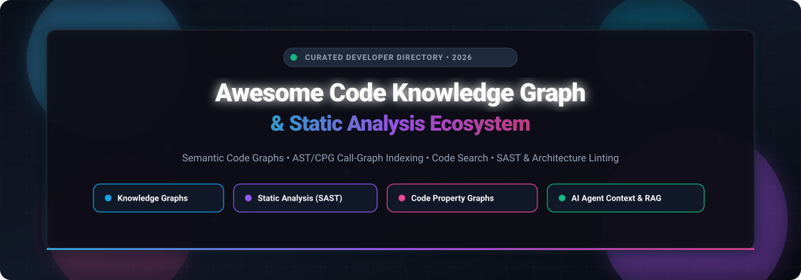
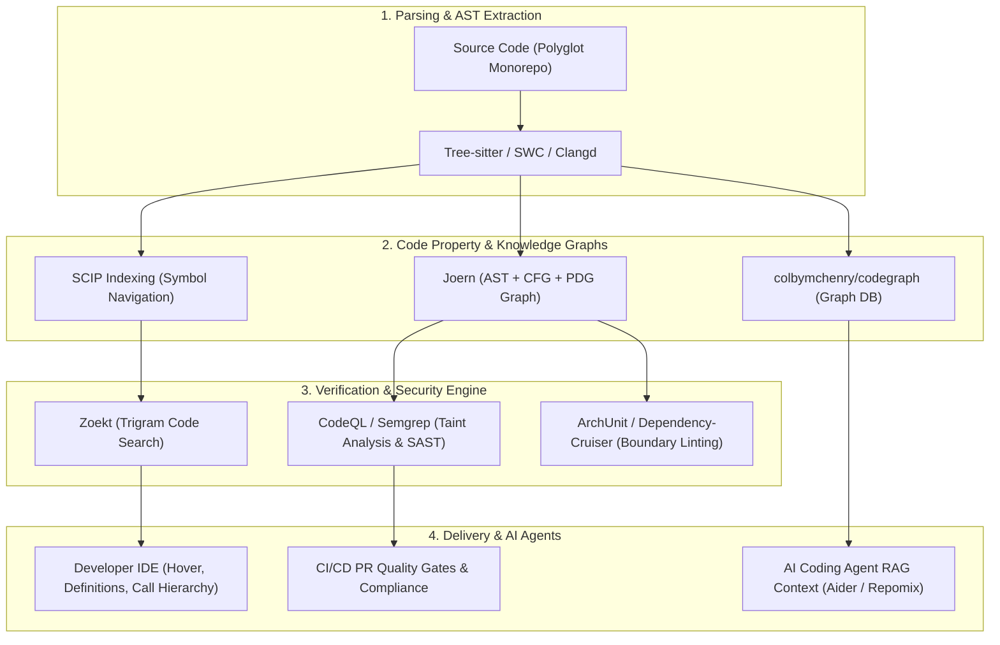

# 🌐 Awesome Code Knowledge Graph & Static Analysis

### *Curated Hub of Knowledge Graphs, AST/CPG Code Intelligence, Static Code Analysis (SAST) & Semantic Indexing for Modern Software Architecture and AI Agents*

  
  
  
  
  

---

**Last updated: November 2026** &bull; **Maintained by [@ishandutta2007](https://github.com/ishandutta2007)**

## 📑 Table of Contents

- [🔍 Overview](#-overview)
- [📈 Sector Overview & Market Dynamics](#-sector-overview--market-dynamics)
- [🏢 SaaS & Commercial Hosted Platforms](#-saas--commercial-hosted-platforms)
- [💻 Open-Source Ecosystem & Frameworks](#-open-source-ecosystem--frameworks)
- [🤝 How to Contribute](#-how-to-contribute)
- [⭐ Support & Community](#-support--community)
- [📊 Star History](#-star-history)
- [⚖️ Disclaimer](#️-disclaimer)

---

## 🔍 Overview

This repository is an authoritative directory indexing tools, engines, and frameworks that turn source code into **Code Knowledge Graphs**, **Abstract Syntax Trees (AST)**, **Code Property Graphs (CPG)**, and **Static Application Security Testing (SAST)** pipelines. 

As codebases scale into millions of lines and AI coding assistants become autonomous agents, understanding code dependencies, symbol call hierarchies, data-flow taint analysis, and architectural boundary violations has transitioned from an optional developer luxury into core platform infrastructure.

Whether you are building codebase-aware Retrieval-Augmented Generation (RAG) contexts for LLMs, auditing microservices for zero-day vulnerabilities, or untangling monolithic circular dependencies, this guide categorizes both leading commercial SaaS platforms and premier open-source repositories.

---

## 📈 Sector Overview & Market Dynamics

The global **Static Code Analysis and Software Intelligence** market is estimated at **$1.15 billion to $1.45 billion in 2025–2026**, expanding rapidly at an 8%–14% CAGR, while specialized cloud-native Static Application Security Testing (SAST) and AI-driven code context engines exceed 20%+ annual growth fueled by regulatory compliance (such as the EU Cyber Resilience Act and federal SBOM mandates).

The sector exhibits a **hybrid market structure**:
- **Enterprise Core (Concentrated):** The top tier for enterprise security, continuous compliance, and governance is highly concentrated among mega-cap conglomerates and well-funded leaders (Microsoft/GitHub, Sonar, Synopsys, CAST, Veracode) with substantial multi-year enterprise contracts.
- **Developer Tooling & Knowledge Graphs (Moderately Fragmented):** Conversely, the developer-first code navigation, architectural visualization, and AI coding agent context tier remains moderately fragmented, where agile open-source engines (Tree-sitter, Semgrep, Joern, SCIP, Zoekt, Repomix) innovate rapidly and serve as the composable building blocks for the next generation of code intelligence.

---

## 🏢 SaaS & Commercial Hosted Platforms

The following SaaS and hosted software intelligence platforms provide deep repository indexing, automated PR quality gates, architectural compliance, and cloud-hosted code knowledge graphs.

> *Sorted in descending order by parent company scale (valuation / annual revenue).*

| Platform | Parent Company Scale (Valuation / Revenue) | Starting Price (Paid Tier) | Free Tier / Free Trial Limits | Core Focus & Capabilities |
| :--- | :--- | :--- | :--- | :--- |
| **[GitHub Code Scanning (CodeQL)](https://github.com)** | **$3.6T+ Market Cap** (Microsoft) / **$2B+ ARR** (GitHub) | **$30 / active committer / month** (GitHub Code Security SKU) | **Free forever for all public repositories**; 30-day trial for GitHub Enterprise Cloud private repos | Enterprise semantic code analysis engine querying codebases like relational data to trace data flow and taint vulnerabilities. |
| **[SonarQube Cloud (SonarCloud)](https://sonarsource.com)** | **$4.7B Valuation** (Series B) / **~$100M+ ARR** (Sonar) | **$34 / month** (Team Plan for 100,000 LOC) | **Free forever for private repos up to 50,000 LOC** (up to 5 users); **Unlimited free analysis for all public/open-source repos** | Continuous automated static analysis, security vulnerabilities, code smell detection, and automated PR quality gates across 30+ languages. |
| **[Sourcegraph](https://sourcegraph.com)** | **$2.6B Valuation** (Series D) / **~$50M ARR** | **~$19 / user / month** (Enterprise starter tier; annual billing) | **14-day full feature trial** (Direct enterprise evaluation); Free individual Cody plans sunsetted in favor of enterprise Cody & universal search | Multi-repo semantic code intelligence, SCIP symbol graph search, cross-repository symbol navigation, and Cody codebase context engine. |
| **[Embold](https://embold.io)** | **$4B Valuation** (Parent BrowserStack) / **~$200M+ ARR** | **Quote-based Enterprise license** (Starting around $299/mo for platform tiers) | **14-day free enterprise trial** (Full engine analysis on internal codebases; cloud free tier deprecated in favor of on-prem enterprise deployments) | AI-assisted static analysis and software analytics evaluating design anti-patterns, maintainability metrics, and security smells. |
| **[CAST Imaging](https://castsoftware.com)** | **~$150M+ Valuation** (€139M Bridgepoint Buyout) / **~$50M ARR** | **Custom enterprise quote** (Tiered by application portfolio volume) | **30-day free trial** (CAST Imaging Express limited to 1 application under 250,000 LOC) | Reverse-engineers complex enterprise software architectures into interactive multi-layer knowledge graphs, data schemas, and transaction call paths. |
| **[GitKraken (GitLens & Workspaces)](https://gitkraken.com)** | **~$15M ARR** (Private Equity backed by Resurgens) | **$4.00 / user / month** (Pro tier; billed annually at $48/yr) | **Free forever for local & public repositories** (Commit Graph, blame annotations, CodeLens); **14-day free trial** of Pro features for private repos | Visual Git repository intelligence, visual interactive commit graph, code ownership maps, and multi-repo workspace tracking. |
| **[CodeScene](https://codescene.com)** | **€11.8M Raised** (Series A Neqst/Luminar) / **~$5M ARR** | **€18 (~$20) / active author / month** (Standard tier, billed annually) | **Free forever for open-source / public repositories**; **30-day fully functional free trial** for private repositories (no credit card required) | Behavioral code analysis combining static code health metrics with version-control history hotspots, developer knowledge distribution, and team coupling. |
| **[Understand by SciTools](https://scitools.com)** | **Bootstrapped / Private** (Leading specialized IDE) | **$100 / user / month** ($1,200/yr per user seat; annual minimum) | **15-day free trial** (Full desktop analysis for evaluation; **Free lifetime academic license** for verified students and qualifying OSS projects) | Comprehensive static analysis IDE delivering control-flow graphs, call trees, dependency matrices, architecture linting, and metric enforcement. |
| **[Structure101 (Sonar Architecture)](https://structure101.com)** | **Acquired by Sonar** ($4.7B valuation ecosystem) | **Integrated into Sonar Enterprise** | **Legacy free trial suspended** (Capabilities integrated directly into Sonar's enterprise architectural governance solution) | Visual software architecture modeling and dependency governance suite detecting cyclic dependencies and enforcing strict layering boundaries. |

---

## 💻 Open-Source Ecosystem & Frameworks

Explore leading open-source repositories powering AST parsing, Code Property Graphs (CPGs), semantic code search, architectural linting, and LLM codebase context packagers.

> *Sorted in descending order by GitHub Stars_Count.*

| Repository | GitHub_Stars | Primary Language | Description |
| :--- | :--- | :--- | :--- |
| **[colbymchenry/codegraph](https://github.com/colbymchenry/codegraph)** |  | TypeScript / Python | Open-source code knowledge graph and codebase indexing tool engineered to map symbols, relationships, and structural dependencies for developer exploration and AI agent context. |
| **[Aider-AI/aider](https://github.com/Aider-AI/aider)** |  | Python | AI pair programming terminal tool featuring **RepoMap**, an incremental Tree-sitter powered semantic graph generator that compresses relevant repository symbols into LLM context prompts. |
| **[swc-project/swc](https://github.com/swc-project/swc)** |  | Rust | Super-fast 20x–70x Rust-based JavaScript/TypeScript compiler providing lightning-fast AST construction, code analysis, and transformation primitives. |
| **[yamadashy/repomix](https://github.com/yamadashy/repomix)** |  | TypeScript | Powerful repository context packager that consolidates codebases, directory file trees, and source metadata into structured formats optimized for LLM code understanding. |
| **[tree-sitter/tree-sitter](https://github.com/tree-sitter/tree-sitter)** |  | C / Rust | Foundational incremental parsing library providing concrete syntax trees with zero latency; powers modern IDE syntax highlighting, code search, and symbol graph extraction. |
| **[semgrep/semgrep](https://github.com/semgrep/semgrep)** |  | OCaml / Python | Fast, lightweight static analysis engine for finding bugs, detecting CVEs, and enforcing security policies using intuitive pattern queries that look like actual source code. |
| **[ast-grep/ast-grep](https://github.com/ast-grep/ast-grep)** |  | Rust | Lightning-fast CLI tool and library for code structural search, linting, and programmatic code rewriting based on abstract syntax trees across dozens of languages. |
| **[CoatiSoftware/Sourcetrail](https://github.com/CoatiSoftware/Sourcetrail)** |  | C++ | Iconic cross-platform interactive source code explorer that merges interactive dependency graphs, concise code inspection views, and fast symbol lookup for C, C++, Java, and Python. |
| **[facebook/infer](https://github.com/facebook/infer)** |  | OCaml | Advanced static analyzer developed by Meta that applies separation logic and bi-abduction to prove the absence of null pointer exceptions, resource leaks, and concurrency race conditions. |
| **[microsoft/pyright](https://github.com/microsoft/pyright)** |  | TypeScript | Blazing-fast static type checker and type-inference engine for Python, powering Pylance and deep symbol resolution in VS Code. |
| **[SonarSource/sonarqube](https://github.com/SonarSource/sonarqube)** |  | Java | Industry-standard self-hosted open-source continuous inspection platform for automated static analysis, security vulnerabilities, technical debt measurement, and coverage tracking. |
| **[github/codeql](https://github.com/github/codeql)** |  | QL / C++ | Industry-standard open-source queries and libraries for semantic code analysis that treats source code as relational database records to track data taint flows and zero-days. |
| **[sverweij/dependency-cruiser](https://github.com/sverweij/dependency-cruiser)** |  | JavaScript | Validates and visualizes JavaScript, TypeScript, and ESM dependencies; enforces architectural boundary rules and exports graphs into SVG, DOT, and Mermaid formats. |
| **[facebook/pyre-check](https://github.com/facebook/pyre-check)** |  | OCaml / Python | Performant type checker and static security analysis tool for Python with full taint-tracking capabilities (Pysa) engineered for giant codebases. |
| **[oracle/opengrok](https://github.com/oracle/opengrok)** |  | Java | Fast and usable source code search and cross-reference engine designed to parse, index, and navigate massive enterprise code repositories. |
| **[MaskRay/ccls](https://github.com/MaskRay/ccls)** |  | C++ | C/C++/Objective-C language server providing lightning-fast cross-references, call hierarchies, inheritance trees, and symbol indexing backed by Clang. |
| **[TNG/ArchUnit](https://github.com/TNG/ArchUnit)** |  | Java | Extensible Java architecture testing library that validates layer dependencies, cyclic references, package isolation, and class design rules directly as JUnit tests. |
| **[joernio/joern](https://github.com/joernio/joern)** |  | Scala | Open-source code analysis platform built on **Code Property Graphs (CPGs)**—merging AST, Control Flow Graphs (CFG), and Program Dependence Graphs (PDG) into a high-performance graph database. |
| **[google/kythe](https://github.com/google/kythe)** |  | C++ / Go | Pluggable, language-agnostic ecosystem developed by Google for building tools that analyze and index source code into an interoperable semantic graph. |
| **[thebjorn/pydeps](https://github.com/thebjorn/pydeps)** |  | Python | Visualizes Python module dependency graphs, detects internal cycles, and outputs visual graphs to highlight structural architecture. |
| **[sourcegraph/zoekt](https://github.com/sourcegraph/zoekt)** |  | Go | Blazing-fast trigram-based regex code search engine (developed by Google & Sourcegraph) optimized for large monorepos and cross-repository search indexes. |
| **[seddonym/import-linter](https://github.com/seddonym/import-linter)** |  | Python | Custom architecture linter for Python applications that guarantees clean separation of layers and prevents unwanted imports between internal sub-packages. |
| **[sourcegraph/scip](https://github.com/sourcegraph/scip)** |  | Protobuf / Go | SCIP Code Intelligence Protocol (modern successor to LSIF) establishing cross-language schemas and fast indexers for precise go-to-definition and symbol dependency graphs. |
| **[github/stack-graphs](https://github.com/github/stack-graphs)** |  | Rust | GitHub's framework for fast, incremental, zero-build name resolution and symbol definitions using scoped name-binding graphs built on Tree-sitter. |
| **[vitsalis/PyCG](https://github.com/vitsalis/PyCG)** |  | Python | Practical static call graph generator for Python repositories supporting higher-order functions, class inheritance, and dynamic attribute lookups. |

---

## 🛠️ Architecture Recommendation Stack

Looking to assemble an end-to-end code intelligence pipeline? Here is a tested reference architecture:

---

## 🤝 How to Contribute

Contributions are warmly encouraged! To propose a new tool or suggest updates:

1. **Fork** this repository.
2. **Add or edit entries** in [README.md](file:///C:/Users/ishan/Documents/Projects/Awesome-Code-Knowledge-Graph-Static-Analysis/README.md) preserving table formatting and descending order conventions.
3. **Include details**: Tool Name, Link, Parent valuation/revenue or Stars_Count, pricing/limits, and a concise 1–2 sentence capability description.
4. **Submit a Pull Request** with a clear explanation of why the tool is valuable for code knowledge graphs or static analysis.

---

## ⭐ Support & Community

If this curated ecosystem helps your software architecture, platform engineering, security audit, or AI context pipeline:

- ⭐ **Star this repository** to help fellow engineers and researchers find it.
- 🍴 **Fork & Share** with your colleagues on [X (Twitter)](https://twitter.com), [LinkedIn](https://linkedin.com), and developer forums.
- 💬 **Join the Discussion** in our [Discord Community](https://discord.gg/jc4xtF58Ve) to discuss code knowledge graphs, SAST patterns, and AI agent architectures.
- ☕ **Support Ongoing Maintenance**: If you'd like to sponsor continued updates and new project evaluations, you can buy me a coffee via the **[GitHub Sponsor Dashboard](https://github.com/sponsors/ishandutta2007)**!

---

## 📊 Star History

---

## ⚖️ Disclaimer

- This is an independent, community-curated list. Product names, logos, and trademarks belong to their respective owners.
- Public GitHub Stars_Counts, pricing figures, and corporate metrics are sampled and updated periodically. Check official project documentation for active licensing requirements and enterprise SLA specifications.
- Indexing large-scale monorepos into deep Code Property Graphs (`Joern`, `CodeQL`) requires adequate RAM and disk IOPS during the initial compilation and indexing pass.

  Engineered with care for software architects, AppSec teams, platform engineers, and AI coding agent developers.

# Awesome-Code-Knowledge-Graph-Static-Analysis

# Awesome Cloud Storage & Decentralized Drive Sync 🌟

> **Top Cloud Storage Decentralized Drive Sync (Opensource)**  

> A curated list of the best cloud storage, file synchronization, and decentralized drive solutions — with a strong focus on **open-source** and self-hostable alternatives.  

> 🌟 **Star if you like it!** 🌟

Cloud storage and file sync services keep documents, photos, and data accessible across devices. Commercial platforms such as Dropbox, Google Drive, OneDrive, MEGA, and Tresorit dominate the hosted space, while a mature open-source ecosystem offers full data ownership through self-hosted servers (Nextcloud, Seafile), peer-to-peer sync (Syncthing), and decentralized networks (IPFS, Sia, Storj-related projects).

This list prioritizes **open-source GitHub projects and self-hostable tools** while keeping SaaS/hosted platforms clearly separated.

## Table of Contents

- [SaaS / Hosted Platforms](#saas--hosted-platforms)

- [Open-Source GitHub Projects](#open-source-github-projects)

- [How to Contribute](#how-to-contribute)

- [Disclaimer](#disclaimer)

## SaaS / Hosted Platforms

These are popular commercial cloud storage and encrypted drive services (closed-source / hosted):

- **[Dropbox](https://www.dropbox.com/)** — Classic file sync and sharing platform with strong collaboration features.

- **[Google Drive](https://drive.google.com/)** — Integrated cloud storage tightly coupled with Google Workspace.

- **[OneDrive](https://www.microsoft.com/en-us/microsoft-365/onedrive/online-cloud-storage)** — Microsoft’s cloud storage, deeply integrated with Windows and Microsoft 365.

- **[Box](https://www.box.com/)** — Enterprise-focused content management and collaboration platform.

- **[pCloud](https://www.pcloud.com/)** — European cloud storage with client-side encryption options and lifetime plans.

- **[MEGA](https://mega.nz/)** — Privacy-oriented cloud storage with end-to-end encryption and generous free tiers.

- **[Sync.com](https://www.sync.com/)** — Canadian zero-knowledge encrypted cloud storage.

- **[Icedrive](https://icedrive.net/)** — Modern cloud storage with strong encryption and competitive pricing.

- **[Tresorit](https://tresorit.com/)** — High-security end-to-end encrypted cloud storage aimed at businesses and privacy-conscious users.

- **[Nextcloud Hub](https://nextcloud.com/)** — Hosted/managed offering of the popular open-source platform (commercial support available).

## Open-Source GitHub Projects

Open-source alternatives and self-hostable tools for file synchronization, personal clouds, and decentralized storage. These give you full control over your data.

### Self-Hosted Personal Cloud & File Sync

- **[nextcloud/server](https://github.com/nextcloud/server)** (Nextcloud)  

  The leading open-source personal cloud platform. File sync & share, calendar, contacts, office suites (Collabora/OnlyOffice), Talk, and a large app ecosystem. Closest full-featured alternative to Google Drive / Dropbox. AGPL-3.0.

- **[haiwen/seafile](https://github.com/haiwen/seafile)** (Seafile)  

  High-performance open-source file sync and share platform. Excellent delta sync, library-based organization, and strong reliability with large numbers of files. Community Edition is fully open-source.

- **[owncloud/core](https://github.com/owncloud/core)** (ownCloud)  

  Mature open-source file sync and collaboration platform. Focus on enterprise features, sharing, and integration. AGPL.

- **[pydio/cells](https://github.com/pydio/cells)** (Pydio Cells)  

  Modern open-source content collaboration platform with strong sharing and external collaboration capabilities.

### Peer-to-Peer & Lightweight Sync

- **[syncthing/syncthing](https://github.com/syncthing/syncthing)**  

  Continuous peer-to-peer file synchronization. No central server required — devices sync directly with each other. Extremely lightweight, private, and reliable. MPL-2.0. One of the most popular open-source sync tools.

- **rclone**  

  Command-line program to manage files on cloud storage. Supports dozens of providers (including S3-compatible, Google Drive, Dropbox, etc.) and can be used for backups, mounts, and synchronization.

### Decentralized & Distributed Storage

- **IPFS (InterPlanetary File System)** — [ipfs/kubo](https://github.com/ipfs/kubo) and related projects  

  Content-addressed, peer-to-peer distributed file system. Foundation for many decentralized storage solutions.

- **Sia / SiaFoundation projects**  

  Decentralized cloud storage network with open-source host and renter software. Files are encrypted, erasure-coded, and distributed across hosts.

- **Storj-related open-source components and connectors**  

  Decentralized object storage with S3-compatible APIs and community tools for integration with IPFS and other systems.

- **Filecoin ecosystem tools**  

  Incentivized decentralized storage layer often used together with IPFS for persistent, verifiable storage.

### Other Notable Open-Source Projects

- **[spacedriveapp/spacedrive](https://github.com/spacedriveapp/spacedrive)**  

  Open-source cross-platform file explorer powered by a virtual distributed filesystem written in Rust. Aims to unify local and remote storage in one interface.

- **[spacesdrive/twiligent](https://github.com/spacesdrive/twiligent)**  

  Self-hosted analytics and publishing dashboard (YouTube + Instagram focus). Included as referenced; demonstrates privacy-first, locally controlled data tools in a related domain.

- Additional tools such as SFTPGo, SeaweedFS, MinIO (S3-compatible object storage), and various WebDAV/SFTP servers that complement personal cloud setups.

> **Tip**: For a full Google Drive / Dropbox-style experience self-host **Nextcloud**. For maximum sync speed and reliability with large libraries try **Seafile**. For pure device-to-device sync with zero central server use **Syncthing**. Decentralized options (IPFS + Filecoin/Sia/Storj) suit censorship resistance and long-term archival use cases.

## How to Contribute

Contributions are welcome and encouraged!

1. Fork the repository

2. Add a new tool under the appropriate section (keep SaaS and Open-Source strictly separate)

3. Use the same format: **Name** — short description + key features + license/link

4. Prefer actively maintained projects with clear documentation, security track records, and preferably cross-platform clients

5. Submit a Pull Request

Please keep descriptions neutral and factual. Open-source and self-hostable projects are the primary focus of this list. Clearly note any enterprise editions or dual-licensing.

## Disclaimer

This is a community-curated list for informational and educational purposes only.  

Inclusion does not constitute an endorsement.  

Self-hosting means you are responsible for backups, security updates, encryption key management, and availability. Decentralized networks involve additional complexity (tokens, hosts, retrieval). Always review licenses, threat models, and operational requirements before migrating critical data.

Commercial services offer convenience and support at the cost of trusting a third party with your files. Choose according to your privacy needs, technical ability, and budget.

---

**Made with ❤️ for the open-source privacy and self-hosting community**  

If this list helped you, please ⭐ the repo!
